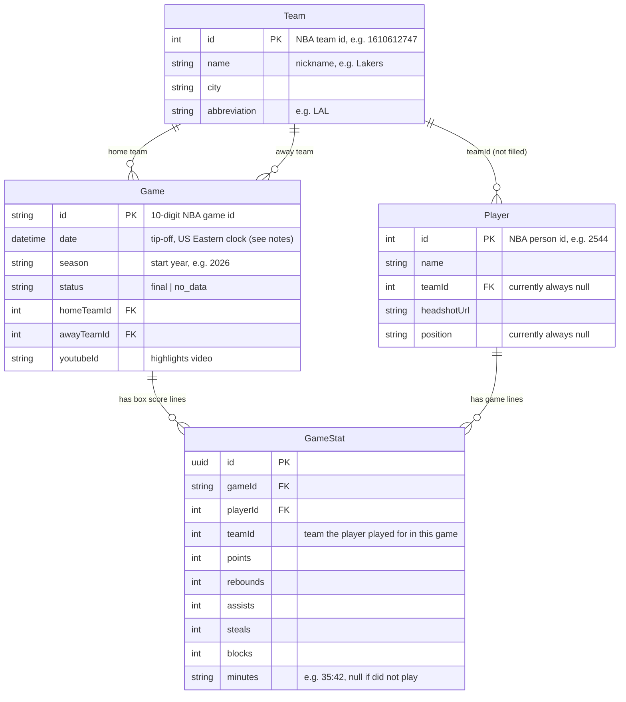

# BoxScore NBA data: how it's collected and how it fits together

This document describes how BoxScore collects NBA game and player statistics,
how they are stored, and how the tables relate. It ends with what the data can
and can't answer for forecasting (for example the
[Forecasters Challenge](https://theforecasterschallenge.com/)) and what to add
to cover the rest.

Based on the code as of November 2026 (`server/python`, `server/src/controllers/gameController.js`,
`server/lib/gameSync.js`, `server/prisma/schema.prisma`).

---

## 1. Where the data comes from

All NBA data comes from **stats.nba.com**, the NBA's public stats site, through the
open-source Python library [`nba_api`](https://github.com/swar/nba_api). There's
no official NBA API or key involved.

| nba_api endpoint | Used by | Gives |
|---|---|---|
| `BoxScoreTraditionalV3` | `fetchSingleGame.py` | Every player's line for one game, plus team IDs and names |
| `BoxScoreSummaryV3` | `fetchSingleGame.py` | The game's tip-off time (`gameEt`) |
| `LeagueGameFinder` (team mode) | `finishedGames.py`, `recentGames.py`, `searchGames.py`, `smartSearch.py` | Lists of games (ID, date, matchup, W/L) for date ranges, seasons or teams |
| `LeagueGameFinder` (player mode) | `playerMatchup.py`, `playerTeams.py`, `smartSearch.py` | One row per game a player played, with full shooting, turnovers, fouls, +/- |
| `PlayerCareerStats` | `playerSummary.py` | Season-by-season and career totals |
| `PlayerAwards` | `playerSummary.py` | MVP count |
| `ShotChartDetail` | `shotChart.py` | Every shot attempt in a game with court x/y, quarter, made/missed |
| `nba_api.stats.static` (players, teams) | search, pyramid editor | Built-in player and team lists (no network request) |

Championships are counted from `server/python/champions.json`
(season → champion team abbreviation), not from the NBA.

### How requests reach the NBA

stats.nba.com blocks requests from cloud servers, so requests take this path:

```
DigitalOcean server ──Tailscale──▶ laptop relay (proxy.py) ──home internet──▶ stats.nba.com
```

Every script imports `nba_guard.py`, which:

- spaces requests out: one every `NBA_MIN_GAP` seconds (default 2.5) plus up to
  `NBA_JITTER` seconds (default 1) of randomness, shared across all scripts;
- routes them through `NBA_PROXY` (the laptop relay);
- pauses all NBA requests after an "Access Denied" response: 15 minutes, then
  30, 60 and so on up to 6 hours if blocks repeat.

Node (`server/lib/nba.js`) also checks that the relay is reachable before
starting a script, and serves the last saved data when the NBA can't be reached.

---

## 2. How games get collected

There are two ways a game ends up in the database.

### a) Daily sync (scheduled)

`server/lib/gameSync.js`, enabled with `GAME_SYNC=on`, runs at **2:30 PM and
9:00 PM Philippine time**, after that night's US games have finished:

1. `finishedGames.py` calls `LeagueGameFinder` for the last 3 days (US Eastern
   dates) and keeps finished games (those with a W/L) of the chosen types.
   Default: regular season, playoffs, play-in and NBA Cup final.
2. Games already saved with stats are skipped.
3. Each remaining game is fetched with `fetchSingleGame.py`, one at a time, with
   a 5-second pause between games, and saved.
4. YouTube highlights are matched for the newly saved games.

It can also be run by hand:

```
docker compose exec api node scripts/syncGames.js --days 3
docker compose exec api node scripts/syncGames.js --days 2 --types 001   # preseason
```

### b) On demand

Opening a game page that isn't saved yet (or reviewing it) fetches it with the
same `fetchSingleGame.py` and saves it. Search results, matchups and older games
therefore enter the database only when someone opens them.

### What `fetchSingleGame.py` returns

```jsonc
{
  "gameId": "0022600123",
  "available": true,
  "date": "2026-10-21T19:30:00Z",          // from BoxScoreSummaryV3 gameEt (see note in section 4)
  "homeTeam": { "id": 1610612747, "name": "Lakers", "city": "Los Angeles", "tricode": "LAL" },
  "awayTeam": { "id": 1610612744, "name": "Warriors", "city": "Golden State", "tricode": "GSW" },
  "playerCount": 26,
  "stats": [
    { "playerId": 2544, "name": "LeBron James", "teamId": 1610612747,
      "points": 28, "rebounds": 9, "assists": 11, "steals": 1, "blocks": 0,
      "minutes": "35:42" }
    // ...one entry per player on both rosters
  ]
}
```

Only those six numbers are kept per player. The box score response contains many
more (shooting splits, threes, turnovers, fouls, +/-, starter position), but they
are currently dropped.

### Saving (`saveNbaGame` in `gameController.js`)

- **Game:** upserted by `id`.
  - `season` = `"20" + gameId[3..4]` (season start year, e.g. `"2026"` for 2026-27).
  - `status` = `"final"` if any player stats came back, otherwise `"no_data"`.
- **Teams:** created if missing (`id`, `name`). City and abbreviation come from
  the one-time `teams.sql` seed.
- **Players:** created if missing (`id`, `name`, `headshotUrl`). `teamId` and
  `position` are not filled.
- **GameStat rows:** one per player per game. Re-fetching a game **replaces** all
  its stat rows (delete then insert), so corrections from the NBA are picked up.

---

## 3. Database tables and how they relate

PostgreSQL (Supabase), managed by Prisma. Only the NBA-data tables are shown;
users, reviews, lists and pyramids hang off `Game` and `Player` but aren't
statistics.



Key points:

- **`GameStat` is the core table:** one row per (game, player), enforced by a
  unique key on `(gameId, playerId)`.
- **A player's team is per game:** use `GameStat.teamId`, not `Player.teamId`.
  This also handles trades correctly.
- **Team scores aren't stored:** a team's score is the sum of its players'
  `points` for that game. The site computes it the same way.
- **Winner and loser** come from comparing the two summed scores.
- **Game IDs encode the game type:** characters 1–3 are `001` preseason, `002`
  regular season, `003` All-Star, `004` playoffs, `005` play-in, `006` NBA Cup
  final. Characters 4–5 are the season's start year.

### Not stored in the database

| Data | Where it lives |
|---|---|
| Shot charts | Fetched on demand. Finished games are saved as JSON files on the server (`cache/data/shots-<gameId>.json`) |
| Player season and career averages, MVPs, titles | Fetched on demand, kept in memory for 24 hours |
| Player head-to-head matchups (with FG%, 3P%, +/-, Game Score) | Fetched on demand, kept in memory for 24 hours |

---

## 4. Data quality notes

- **Coverage is incomplete.** The database holds games since the daily sync went
  live (mid-October 2026), the suggested classics, a few preseason games, and any
  older game a user opened. It is **not** a full historical record, so a forecasting
  model needs a separate backfill (section 6).
- **Players who didn't play** are included in the box score with `minutes` =
  `null` and zeros elsewhere. Filter on `minutes IS NOT NULL` before counting
  players or averaging.
- **Game dates:** `gameEt` is the US Eastern tip-off time but arrives with a `Z`
  suffix, so it's stored as if it were UTC. A 7:30 PM ET game shows as
  `19:30:00Z`. The date part is the correct US game date; treat the time as
  Eastern.
- **Missing values:** steals, blocks, rebounds and assists default to 0 when the
  NBA leaves them out.
- **Corrections:** stats are replaced on re-fetch. The daily sync only re-fetches
  games that have no stats, so later NBA stat corrections aren't picked up
  automatically.

---

## 5. What the data can answer for the Forecasters Challenge

The challenge asks 10 yes/no questions per game. Using what's stored **today**:

| Question type | Possible with current data? | Needs |
|---|---|---|
| Will the home team win? | ✅ | Sum of `points` per team |
| Will any player score 30+? | ✅ | `points` |
| Will any player on the losing team score 25+? | ✅ | `points` + winner |
| Will 2+ players record a double-double? | ✅ | `points`, `rebounds`, `assists`, `steals`, `blocks` |
| Will any player make 5+ threes? | ❌ | Three-pointers made (in the box score, currently dropped) |
| Will the home bench outscore the away bench? | ❌ | Starter flag (in the box score's player `position`, currently dropped) |
| More turnovers / team fouls? | ❌ | Turnovers, personal fouls (in the box score, currently dropped) |
| Both teams 25+ in the 1st quarter? | ❌ | Per-quarter team scores (game summary / line score) |
| Both teams lead at some point in the 4th? | ❌ | Play-by-play (`PlayByPlayV3`) |

### Example queries (current schema)

Final score and winner per game:

```sql
SELECT g.id, g.date::date AS game_date,
       SUM(s.points) FILTER (WHERE s."teamId" = g."homeTeamId") AS home_pts,
       SUM(s.points) FILTER (WHERE s."teamId" = g."awayTeamId") AS away_pts
FROM "Game" g
JOIN "GameStat" s ON s."gameId" = g.id
WHERE g.status = 'final' AND g.id LIKE '002%'          -- regular season
GROUP BY g.id
ORDER BY game_date;
```

Double-doubles per game:

```sql
SELECT s."gameId", COUNT(*) AS double_doubles
FROM "GameStat" s
WHERE ( (s.points   >= 10)::int + (s.rebounds >= 10)::int + (s.assists >= 10)::int
      + (s.steals   >= 10)::int + (s.blocks   >= 10)::int ) >= 2
GROUP BY s."gameId";
```

A player's recent form (last 10 games played):

```sql
SELECT g.date::date, s.points, s.rebounds, s.assists, s.minutes
FROM "GameStat" s JOIN "Game" g ON g.id = s."gameId"
WHERE s."playerId" = 2544 AND s.minutes IS NOT NULL
ORDER BY g.date DESC
LIMIT 10;
```

---

## 6. Extending the data for forecasting

### a) Keep more from each box score (small change)

`BoxScoreTraditionalV3` already returns these for every player; `fetchSingleGame.py`
just needs to pass them through, and `GameStat` needs the columns:

| New column | V3 field |
|---|---|
| `fgm`, `fga` | `fieldGoalsMade`, `fieldGoalsAttempted` |
| `fg3m`, `fg3a` | `threePointersMade`, `threePointersAttempted` |
| `ftm`, `fta` | `freeThrowsMade`, `freeThrowsAttempted` |
| `oreb`, `dreb` | `reboundsOffensive`, `reboundsDefensive` |
| `turnovers` | `turnovers` |
| `fouls` | `foulsPersonal` |
| `plusMinus` | `plusMinusPoints` |
| `starter` | player `position` is non-empty for starters |

This covers threes, bench points, turnovers and fouls.

### b) Quarter scores and leads

- **Per-quarter team scores:** a small `GameLineScore` table (`gameId`, `teamId`,
  `period`, `points`). It can be filled from the game summary endpoint
  (`BoxScoreSummaryV3`, already called for the date). Check its exact field names
  before relying on it.
- **"Both teams lead in the 4th":** needs play-by-play (`PlayByPlayV3`). Store
  only what's needed, for example each team's largest 4th-quarter lead per game.

### c) Backfill past seasons (for training)

Fetching every old box score one by one is about 1,230 requests per season, which
means hours through the relay and a real risk of getting the home IP blocked. Use
season-wide endpoints instead:

- **`PlayerGameLogs(season_nullable="2025-26")`:** every player's line for every
  game of a season in one request. It includes threes, turnovers, fouls, +/- and
  double-double flags (`DD2`).
- **`LeagueGameFinder` (team mode, per season):** one row per team per game, with
  team totals.
- Box scores (starters) and play-by-play only for the games where they're
  actually needed.

Run backfills as a separate, slow job (one request every 4–6 seconds), outside
the 2:30 PM and 9:00 PM sync times, so the website's own NBA access isn't put at
risk.

---

## 7. Before using it in a competition

- Check the challenge's **Contest Rules** on allowed data sources.
- NBA data is subject to **NBA.com's terms of use**; nba_api is unofficial.
- Forecasts must only use data available **before tip-off**. When training,
  build features from games strictly before each game's date, so the model
  doesn't learn from the result it's predicting.